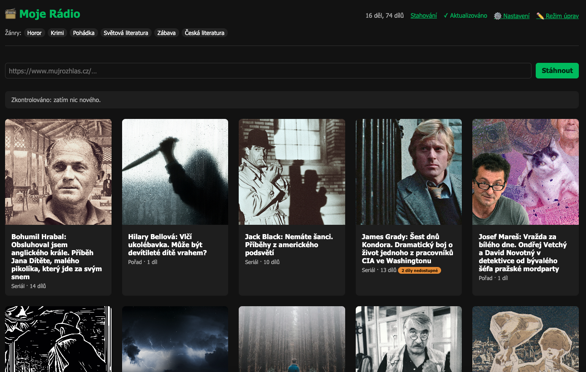

# CRo-DL
Listen to MůjRozhlas.cz programs offline.





## Overview
CRo-DL is a Python-based tool that allows Czech Radio license payers to download and store radio programs locally for offline listening. It supports individual broadcasts, full series, and entire program schedules. Series are saved with episode numbers and user-friendly titles.

⚠️ Respect copyright laws—downloaded content is for personal use only and should not be shared.

## Dependencies
* Python 3.10+ is required.
* Czech Radio mainly uses MP3 and HLS/DASH streams (AAC/M4A).
* FFmpeg is required for handling DASH streams (optional).

## Installation
CRo-DL can be installed via:

### PyPI

```
pip install cro-dl
```

### uv (alternative method)
Download the source code (zip) and sync dependencies:

```
uv sync
uv run cro-dl <url>
```

### Git clone (development mode)
```
git clone git@github.com:klimanek/cro-dl.git
uv sync
uv run cro-dl <url>
```
## Usage
* Open mujrozhlas.cz, find a broadcast, series, or episode.
* Copy the URL from the address bar.
* Run in the terminal:

```
cro-dl <url>
```

If multiple formats are available, MP3 is preferred. You can customize the download using the following options:

* `--stream-format` / `-sf`: Specify format (mp3, hls, dash).
* `--title` / `-t`: Set a custom title for the file or folder.
* `--output` / `-o`: Specify a custom output directory.
* `--no-accents`: Remove diacritics from filenames.

Example with custom settings:
```
cro-dl --title "My-Favorite-Show" --no-accents --output "./my-radio" <url>
```

## Web library

Downloaded works can be browsed in a small local web UI (FastAPI + Jinja2) backed by a SQLite
library in `~/Z Rozhlasu/library.db`:

1. Import what is already on disk (optional):
   ```
   cro-dl --sync
   ```
2. Start the server:
   ```
   cro-dl server
   ```
3. Open <http://127.0.0.1:8000>.

The server listens on `127.0.0.1` only and is meant for personal, local use. It shows the library
as a grid of works with their covers; a work's page has its description and parts, each with a play
button. A player at the foot of every page keeps playing while you browse, and its queue
(`/fronta`) survives a reload. Works can be filtered by genre.

There is more than browsing:

* **Downloading** - paste a mujrozhlas.cz link on the library page (or `/downloads`) and watch it
  there; the same is available as JSON under `/api`.
* **New parts** - "Zkontrolovat nové díly" asks the content API for parts released since. A work
  with something new is marked in the grid and can fetch exactly those parts; parts whose streams
  are gone or that have not aired yet get their own badge. The server checks on its own shortly
  after start and then every six hours.
* **Tags** - title, author, genre, album and track number are written into the audio files
  (MP3/ID3 and M4A/AAC) as they are downloaded, and again on demand.
* **Editing** - "Režim úprav" (edit mode) fixes a work's title, genre and description and a part's
  title, author and description, and writes those tags into the files. A work adopted from disk can
  be given the mujrozhlas.cz page it came from, which makes it refreshable.
* **Folders** - "⚙️ Nastavení" lists the folders that make up the library and imports another one
  (a collection on an external disk). A folder that is not there right now (an unplugged disk) is
  named in a banner.

`--sync` groups the files it finds into works by their folder (the folder name is the work's title),
so a download that predates the library shows up as a single entry with its parts. Starting the
server for development? Use `cro-dl --reload server`; reload is off by default because uvicorn's
reloader walks the whole working directory.

## Contributing

Development setup, the checks CI runs, the minimum Python and the release
process (tag, version, PyPI) are in [CONTRIBUTING.md](CONTRIBUTING.md).


<hr />

### 🇨🇿
# CRo-DL
Poslouchejte pořady z MůjRozhlas.cz i offline.

## Popis
CRo-DL je nástroj umožňující každému koncesionáři ČRo stáhnout si pořady Českého rozhlasu lokálně na své zařízení s motivací je poslouchat mimo dosah vln. Dbejte autorských práv a díla stažená pro vlastní potřebu nešiřte dál.

Podporovány jsou jak jednotlivé rozhlasové příspěvky, tak i celé seriály a kompletní programy -- seriály se stahují s číslem dílu a pod svým názvem. Každý titul je uložen do vlastní složky.

Není-li ještě nějaký díl seriálu dostupný, CRo-DL vás upozorní a uvede datum i čas uvedení.

## Závislosti
Software je napsaný v jazyce Python, proto byste v systému měli mít Python ve verzi alespoň 3.10.

Můjrozhlas.cz v zásadě používá formát mp3 pro svá díla (ČRo) a streamy HLS a DASH pro díla třetích stran. Preferovány jsou formáty mp3 a HLS pro stream. Pokud byste však chtěli z různých důvodů použít DASH, pro vytvoření a uložení finálního souboru je nutné mít v systému nainstalovaný [ffmpeg](https://www.ffmpeg.org/).

Externí balíčky v Pythonu jsou uvedeny ve specifikaci (viz `pyproject.toml`). Při instalaci se stáhnou a nainstalují automaticky.

## Instalace
CRo-DL lze instalovat několika způsoby:

1. PyPi / pip
2. Zip + uv
3. Git clone + uv


### PyPi
Nejčastěji z PyPi pomocí nástroje `pip`:

```
pip install cro-dl
```

### uv
Alternativou je lokální použití CRo-DL pomocí nástroje [uv](https://docs.astral.sh/uv/) poté, co si stáhnete zde zip soubor s codebase.

`uv sync`

Nebo rovnou můžete stáhnout audio soubor z webu s `<url>`

```
uv run cro-dl <url>
```

a všechny závislosti se nainstalují automaticky.


Pro vývoj pak nejlepší bude klonovat zdejší repozitář:

```
git clone git@github.com:klimanek/cro-dl.git
```

## Použití
Otevřete stránku mujrozhlas.cz, najděte si pořad / epizodu / seriál a z adresního řádku zkopírujte aktuální URL. Otevřte terminál a zadejte

```
cro-dl <url>
```

### Pokročilé možnosti stahování
Kromě základního stahování můžete použít následující parametry:

* `--stream-format` / `-sf`: Výběr formátu (mp3, hls, dash).
* `--title` / `-t`: Vlastní název pro soubor nebo složku (vhodné pro přejmenování).
* `--output` / `-o`: Cesta k adresáři, kam se má obsah uložit.
* `--no-accents`: Odstraní diakritiku z názvů souborů a složek.

### Příklad
Chcete-li si pořad stáhnout ve vámi preferovaném formátu, s vlastním názvem a bez diakritiky:

```
cro-dl --title "Můj Pořad" --no-accents --output "./stazeno" https://www.mujrozhlas.cz/leonardo-plus/tuk-da-kazdy-radeji-nez-kostni-dren-endokrinolog-vyviji-novou-lecbu-diabetu-kmenovymi
```

## Webová knihovna

Stažená díla si můžete procházet v malém lokálním webovém rozhraní (FastAPI + Jinja2) nad SQLite
databází v `~/Z Rozhlasu/library.db`:

1. Naimportujte, co už na disku máte (nepovinné):
   ```
   cro-dl --sync
   ```
2. Spusťte server:
   ```
   cro-dl server
   ```
3. Otevřete <http://127.0.0.1:8000>.

Server poslouchá jen na `127.0.0.1` a je určený pro osobní, lokální použití. Knihovnu ukazuje jako
mřížku děl s obaly; stránka díla má popis a díly s tlačítkem přehrání. Přehrávač v zápatí hraje
dál, i když procházíte knihovnu, a jeho fronta (`/fronta`) vydrží i obnovení stránky. Díla lze
filtrovat podle žánru.

Kromě procházení umí:

* **Stahování** - vložte odkaz z mujrozhlas.cz přímo na stránce knihovny (nebo v `/downloads`) a
  sledujte průběh; totéž je k dispozici jako JSON pod `/api`.
* **Nové díly** - „Zkontrolovat nové díly“ se zeptá obsahového API na díly vydané od poslední
  kontroly. Dílo s novinkou je v mřížce označené a umí stáhnout právě ty chybějící díly; díly,
  jejichž stream už skončil, nebo které ještě nebyly odvysílány, mají vlastní označení. Server
  kontroluje sám chvíli po startu a pak každých šest hodin.
* **Tagy** - název, autor, žánr, album a číslo skladby se zapisují do audio souborů (MP3/ID3 a
  M4A/AAC) při stahování a na vyžádání znovu.
* **Úpravy** - „Režim úprav“ umožní opravit název, žánr a popis díla i název, autora a popis
  jednotlivého dílu a zapsat tyto hodnoty do tagů. Dílu převzatému z disku lze přiřadit stránku
  na mujrozhlas.cz, ze které pochází - tím se dá aktualizovat.
* **Složky** - „⚙️ Nastavení“ vypisuje složky, ze kterých se knihovna skládá, a umožňuje přidat
  další (sbírku na externím disku). Složka, která právě není dostupná (odpojený disk), je
  připomenutá v pruhu nad obsahem.

`--sync` seskupí nalezené soubory do děl podle složek (název složky je název díla), takže i
stažení starší než knihovna se objeví jako jeden záznam se svými díly. Pro vývoj lze server
spustit s `cro-dl --reload server`; reload je ve výchozím stavu vypnutý, protože uvicorní
reloader prochází celý pracovní adresář.

## Vývoj a vydávání

Nastavení vývoje i CI pipeline jsou v [CONTRIBUTING.md](CONTRIBUTING.md).
